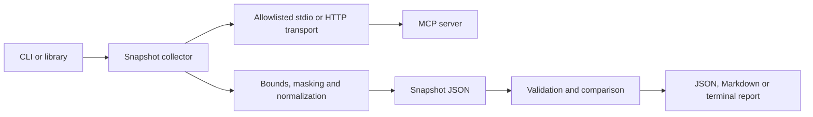

# Architecture

JOONS MCP Diff is independent of JOONS MCP Probe. It snapshots one server at a time and compares two snapshots.

`src/args.js` and `src/cli.js` handle the CLI; `src/index.js` exports the library. Snapshot collection, transport, masking and bounds live under `src/snapshot/`. Normalization and validation are in `src/model/`; compatibility and rename hints are in `src/diff/`; renderers are in `src/report/`.

## Snapshot pipeline

The collector connects, initializes, lists tools page by page, bounds and sanitizes untrusted data, masks secrets, sorts tools and validates the resulting version 1 snapshot. Duplicate names retain the first; masked name collisions are counted. Limits fail without a partial snapshot. Startup and initialization share one step deadline; total and cleanup deadlines also apply.

## Compare pipeline

The CLI validates both snapshots before comparison. Library callers must validate their inputs: `compareSnapshots` does not. Comparison normalizes tools, compares names and schemas, and classifies changes. Complex changed constructs and output schema changes are UNKNOWN. Rename hints use name similarity and canonical input schema equality and are never applied. Risk is high for any BREAKING, otherwise unknown for UNKNOWN, low for NON_BREAKING, or none. Unchanged tools appear only when requested.

## Security model

The transport allowlists only initialization, initialized notification, tool listing and ping; it rejects other methods before sending. Stdio uses a non-shell spawn and a minimal environment plus explicitly selected names. HTTP header values come from environment variables. Secret environment values, header values, and URL userinfo and query values are masked, including encoded variants, in untrusted text; structural keys stay intact. Bounds cap message, total, depth, string, tool and page sizes. Reports neutralize hostile control and formatting characters.

Cleanup is attempted on success, failure, timeout and SIGINT: on POSIX the process group is signaled; on Windows `taskkill` is attempted, followed by a direct-child kill fallback if no exit was observed. Cleanup problems do not replace snapshot errors. Cleanup is bounded, so it does not prove every descendant has exited in all circumstances.

## Non-goals for 0.1

Calling tools, modifying servers, guessing compatibility of complex schema changes, automatically applying renames, storing connection credentials, and depending on Probe are outside the contract. Read-only describes MCP methods, not side effects of starting an arbitrary server process.
